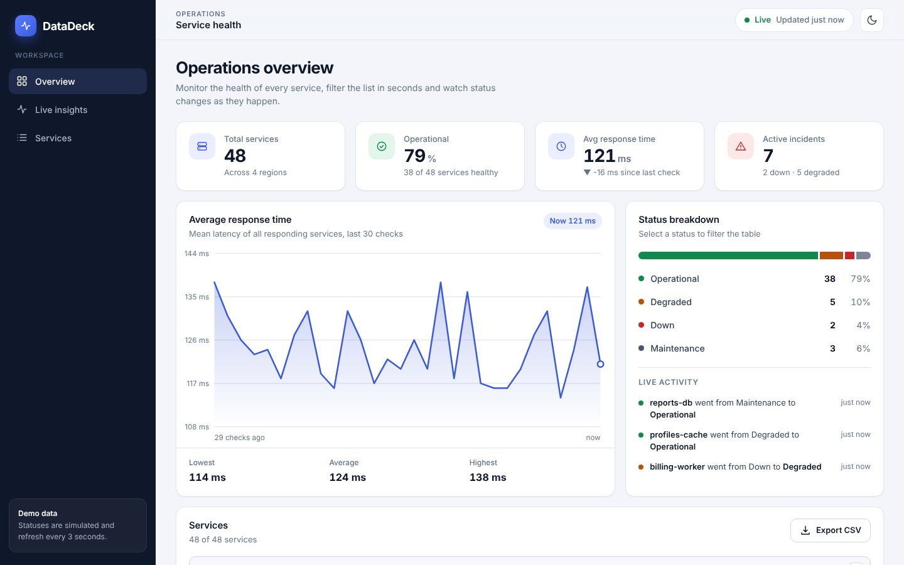
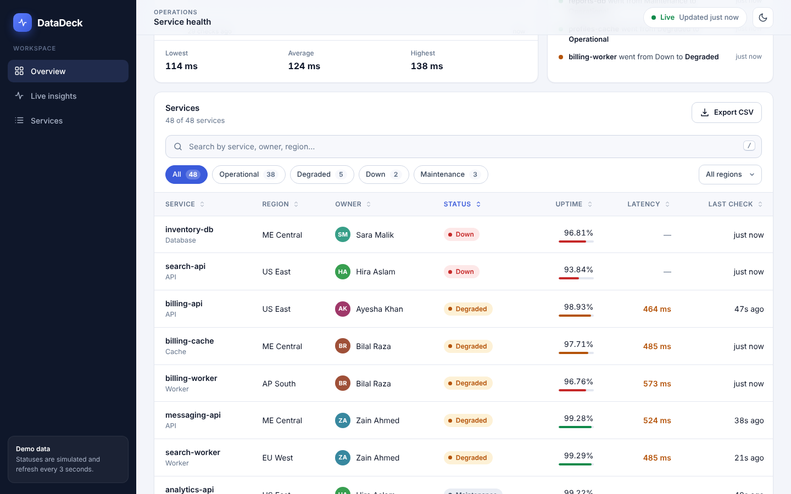
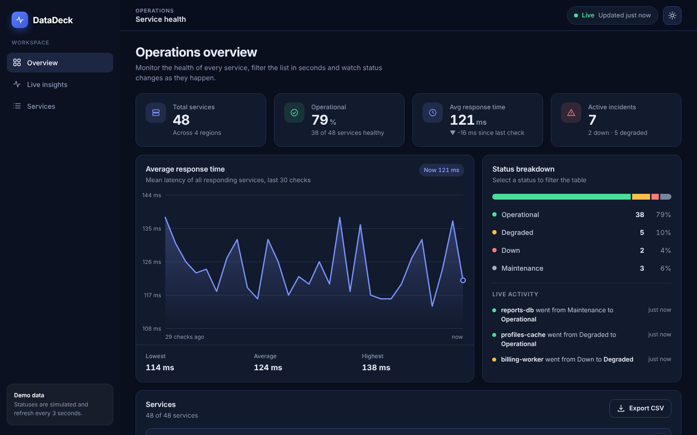
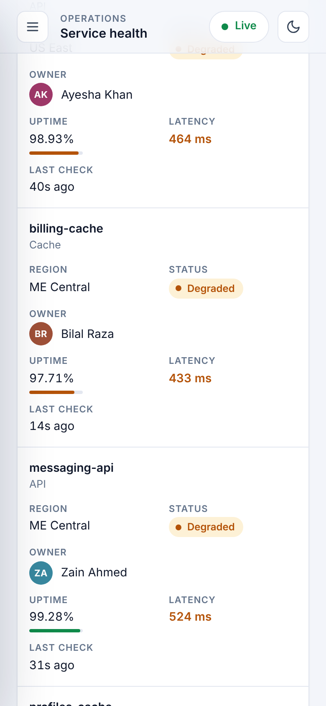

# DataDeck: Interactive Dashboard UI & Data Tables

A responsive operations dashboard with a filterable, sortable, searchable data table and **real-time status pills**.
Built for the Varolline Web Developer internship (Task 3) with plain **HTML, CSS and JavaScript**: no framework, no build step, nothing to install.

**Author:** Mahin Saleem
**Repository:** https://github.com/mahinsaleem001-debug/Web_Developer_Varolline_Task3



## What it does

| Requirement | How it is delivered |
|---|---|
| Responsive dashboard layout | Sidebar + sticky top bar + KPI cards + chart + table. The sidebar becomes a slide-in menu on tablets and phones, and table rows turn into cards on small screens. |
| Filterable data tables | Status chips (with live counts), a region filter, and filters that combine with each other and with the search. |
| Search | Instant search across service, category, owner, region and status. Press `/` to jump to it, `Esc` to clear it. |
| Real-time status pills | Every 3 seconds a simulated monitoring round updates statuses and latencies. Changed pills flash, rows highlight, a live activity feed fills in and a toast appears when a service goes down. A **Live / Paused** switch controls the feed. |

### Extra features

- Sortable columns (click a header again to reverse), with `aria-sort` for screen readers
- Pagination with page-size selector (10 / 25 / 50)
- Row click opens a **details drawer**: 30-day uptime bars and this session's status changes
- KPI cards and a live response-time line chart (hand-drawn SVG, no chart library)
- Status breakdown bar that also works as a filter
- **Export CSV** of exactly the rows you are filtering (with spreadsheet formula injection protection)
- Light and dark theme (remembers your choice, respects the system setting)
- Filters, sorting and page are stored in the URL, so a refresh or shared link keeps the same view
- Friendly empty state, keyboard friendly, respects "reduce motion"

## Screenshots

| Table | Dark theme | Mobile |
|---|---|---|
|  |  |  |

## Run it

No installation needed.

1. Download or clone the project.
2. Open the folder in VS Code and start **Live Server** on `index.html`, **or** simply double-click `index.html`.

To run the unit tests (needs Node.js 18 or newer, no packages to install):

```bash
npm test
```

## Project structure

```
index.html            Page structure and icon sprite
css/style.css         Design tokens (light/dark), layout, components, responsive rules
js/data.js            Demo data + the live status simulation
js/logic.js           Pure functions: filter, sort, paginate, CSV, formatting
js/app.js             UI: rendering, events, drawer, toasts, theme, live updates
tests/logic.test.js   12 unit tests for the logic and the simulation
screenshots/          Images used in this README
```

## How it works (short version)

- **State in one object.** `app.js` keeps one `state` object (search text, filters, sort, page, services). Any change calls `setFilter()`, which updates the URL and re-renders the affected parts. There is a single source of truth.
- **Logic is separated from the UI.** `logic.js` has no DOM code. It filters, sorts and paginates plain arrays, which is why it can be unit-tested in Node.
- **Live feed.** `data.tick()` runs every 3 seconds. About 30% of services get "checked": latency moves a little and the status may change with small probabilities (for example Operational → Degraded 3%). It returns the list of changes, and the UI shows them as flashes, feed items and toasts.
- **Safe rendering.** All text is inserted with `textContent` through a small `el()` helper. Nothing is inserted with `innerHTML`, so data can never inject HTML.
- **Responsive.** CSS Grid and Flexbox with breakpoints at 1200, 1024, 720 and 420 px. On phones each table row becomes a labelled card (`data-label` attributes) and a sort dropdown replaces the clickable headers.
- **Accessible.** Skip link, labelled controls, `aria-pressed` filters, `aria-sort`, focus trap and focus return in the drawer, status shown with text and not by colour alone, visible focus rings.

## Using real data

The data is generated in the browser because this task has no backend. To connect a real API, replace `createServices()` in `js/data.js` with a `fetch()` call and `tick()` with polling or a WebSocket message. The rest of the app does not need to change.

## Tech

HTML5 · CSS3 (custom properties, Grid, Flexbox) · Vanilla JavaScript (ES2020) · Node's built-in test runner

## AI tool usage

This project was built with assistance from an AI tool (Claude). All code was reviewed, run and tested by me, and I can explain how each part works.
